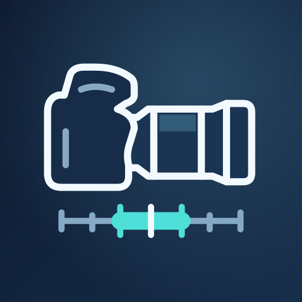
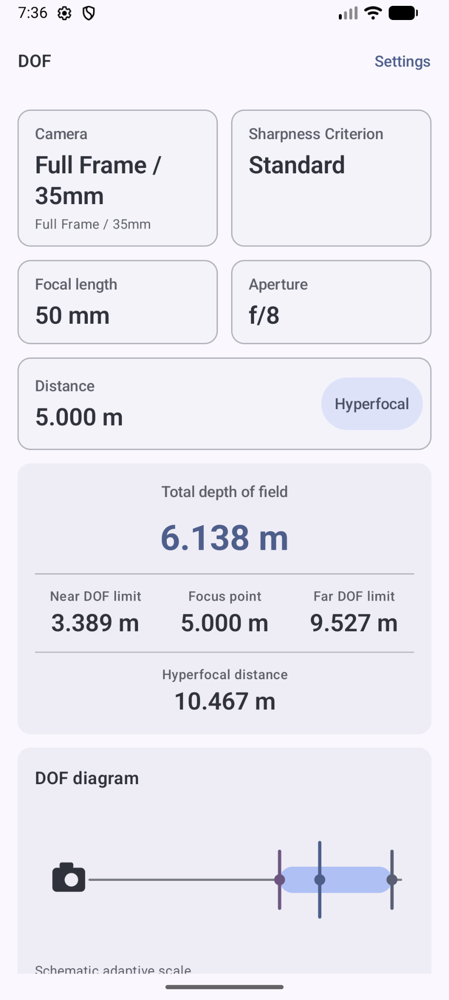
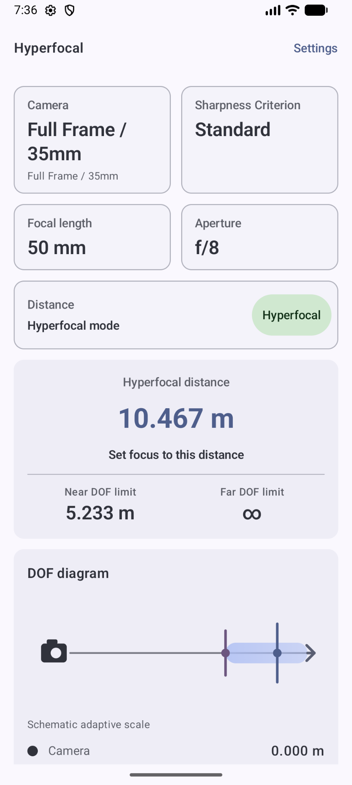
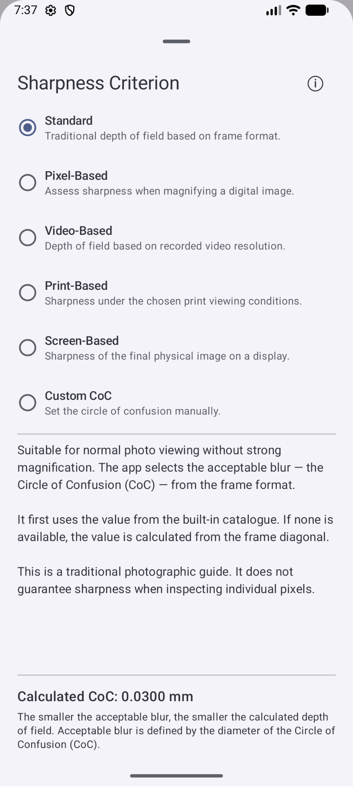

  

  <h1>DoFCraft</h1>

  
<strong>Глубина резкости и гиперфокал — всегда под рукой.</strong>

  
Для фотографии и видео. Без интернета.

  
<strong>Android 8.0+</strong> &nbsp;·&nbsp; <strong>Полностью офлайн</strong> &nbsp;·&nbsp; <strong>Русский / English</strong>

  
<a href="README.md">English</a> &nbsp;|&nbsp; Русский

  
<a href="https://github.com/karrrphoto-hub/DoFCraft/releases/download/v1.0.4/DoFCraft-1.0.4.apk"><strong>Скачать APK · DoFCraft 1.0.4</strong></a>

  
Android 8.0+ &nbsp;·&nbsp; Подписанная Release-сборка &nbsp;·&nbsp; Нужен доступ к репозиторию

  
<a href="https://github.com/karrrphoto-hub/DoFCraft/releases/tag/v1.0.4">Описание релиза и контрольная сумма SHA-256</a>

---

DoFCraft помогает оценить, какая часть сцены будет выглядеть резкой. Выберите камеру, фокусное расстояние, диафрагму и дистанцию — приложение покажет ближнюю и дальнюю границы глубины резкости, её общую величину и наглядную схему.

Для пейзажа переключитесь на гиперфокал: приложение подскажет дистанцию фокусировки, при которой дальняя граница глубины резкости уходит в бесконечность.

<table>
  <tr>
    <th>Глубина резкости</th>
    <th>Гиперфокал</th>
    <th>Критерий резкости</th>
  </tr>
  <tr>
    <td></td>
    <td></td>
    <td></td>
  </tr>
</table>

*Реальные экраны приложения. На скриншотах выбран английский язык; интерфейс также доступен на русском.*

## Возможности

- **ГРИП и гиперфокал.** Ближняя и дальняя границы, общая глубина резкости и схема расположения объекта.
- **Удобная дистанция.** Адаптивный слайдер, ручной ввод и отдельное положение оптической бесконечности.
- **Свои камеры и объективы.** Пользовательские профили с физическими размерами кадра и комплектами фикс- и зум-объективов.
- **Быстрый ввод для выбранного объектива.** Выберите объектив в окне фокусного расстояния, чтобы использовать его фокусные, диафрагмы и единицы шкалы дистанции. Ручной ввод доступен всегда.
- **Подсказки без ограничений.** Независимые сообщения о дифракции и близкой дистанции объясняют особенности расчёта, не меняя параметры съёмки.
- **Настройка под себя.** Русский и английский языки, светлая, тёмная и системная темы, единицы измерения и отображение чисел.

## Резкость под вашу задачу

То, насколько заметно размытие, зависит от того, как рассматривают изображение. В DoFCraft можно выбрать подходящий критерий:

| Критерий | Для чего |
| --- | --- |
| **Standard** | Обычный просмотр фотографии. Использует значение формата из каталога, а при его отсутствии — расчёт по диагонали физического кадра. |
| **Pixel-Based** | Оценка при увеличении цифрового изображения с учётом разрешения сенсора. |
| **Video-Based** | Расчёт с учётом разрешения записываемого видео. |
| **Print-Based** | Печать с выбранными размером и условиями просмотра. |
| **Screen-Based** | Просмотр изображения на выбранном экране. |
| **Custom** | Ручное задание кружка рассеяния (CoC, Circle of Confusion). |

Для Standard без каталожного значения используется традиционный фотографический ориентир: 36×24 мм и кружок рассеяния 0,030 мм, пропорционально диагонали кадра. Явно заданные значения встроенных форматов имеют приоритет.

Расчёты помогают планировать съёмку, но не гарантируют одинаковую детализацию у всех реальных объективов. На близких дистанциях допущения оптической модели могут заметнее расходиться с их характеристиками. Информационные подсказки поясняют эти ограничения, сохраняя доступ ко всем результатам.

## Камеры и быстрые значения

В выборе камеры есть отдельные разделы **«Пользовательские профили камер»** и **«Стандартные профили камер»**. Пользовательские профили идут первыми; пустые разделы скрываются, в том числе при поиске. Во всех списках объективы отсортированы от меньшего фокусного к большему, для зумов — по нижней границе диапазона, независимо от единиц шкалы дистанции.

В описании камеры показаны первые три объектива с буллетами и количество остальных. Единицы шкалы дистанции появляются только при отличии от системы единиц приложения; текущая дистанция фокусировки в выборе камеры не показывается.

Создайте профиль камеры и добавьте свою оптику. В окне **«Фокусное расстояние»** выберите объектив: приложение применит его быстрые фокусные, диафрагмы и единицы шкалы дистанции. Выбор запоминается для каждой камеры. При выборе объектива фокусное и диафрагма вне его диапазона приводятся к ближайшей границе; после этого ручной ввод остаётся доступным.

Для зума показываются стандартные фокусные внутри его диапазона и точные границы. Фикс 58 мм или зум 48–217 мм сохраняют собственные значения. Для каждого объектива в профиле камеры можно выбрать шкалу дистанции в метрах или футах.

Переключатель **«Игнорировать профиль объектива»** общий для окон фокусного и диафрагмы. Он возвращает стандартные быстрые значения и единицы приложения, сохраняя выбранный объектив и физическую дистанцию фокусировки.

Если единицы объектива отличаются от единиц приложения, гиперфокальное расстояние показано в единицах приложения, а в скобках — по шкале объектива. Под результатами есть пояснение, помогающее установить дистанцию на объективе. При смене камеры критерий резкости сбрасывается на Standard; редактирование текущей камеры сохраняет его.

## Без интернета

Приложение работает локально. В нём нет рекламы, аналитики, учётных записей или телеметрии; разрешение на доступ к интернету не запрашивается. Профили и настройки сохраняются на устройстве.

## Установка

1. [Скачайте подписанный Release APK](https://github.com/karrrphoto-hub/DoFCraft/releases/download/v1.0.4/DoFCraft-1.0.4.apk) на смартфон.
2. Откройте файл и при необходимости разрешите браузеру или файловому менеджеру установку приложения.
3. Завершите установку. Требуется Android 8.0 или новее.

На [странице релиза](https://github.com/karrrphoto-hub/DoFCraft/releases/tag/v1.0.4) доступна контрольная сумма SHA-256 для проверки загрузки.

Если ранее была установлена приватная Debug-сборка, Release имеет другую подпись и не обновит её поверх. Сохраните прежнюю установку, если нужны её профили: удаление приложения может стереть данные.

## О репозитории

DoFCraft — единственный приватный репозиторий приложения: здесь находятся исходники, документация, скриншоты и подписанные APK в Releases. Для просмотра страницы и загрузки APK нужен доступ к репозиторию.

---

  <strong>DoFCraft</strong> 
  Планируйте глубину резкости. Сохраняйте свободу выбора.

